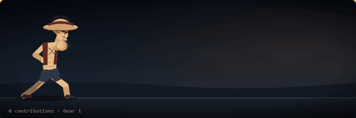

# Luffy Contribution Punch

<p align="center">
  
</p>

An animated SVG for your GitHub profile. Luffy throws a Gum-Gum Pistol, and **your contributions power him up** from Gear 1 all the way to Gear 5. It's free, takes about two minutes to set up, and updates itself every day.

If you like it, a star on the repo helps other people find it.

## See all six forms

<p align="center">
  
</p>

<p align="center"><sub>Gear 1 → Gear 2 → Gear 3 → Gear 4 Boundman → Gear 4 Snakeman → Gear 5. Also available as <a href="assets/luffy-gears.mp4">an MP4</a> for sharing.</sub></p>

## How it works

Luffy gets a new form **every 400 contributions**. It is the same rule for everyone.

| Your contributions (last 12 months) | Luffy's form |
|---|---|
| 0 | Gear 1 |
| 400 | Gear 2 |
| 800 | Gear 3 |
| 1,200 | Gear 4 · Boundman |
| 1,600 | Gear 4 · Snakeman |
| 2,000 | Gear 5 |

Between forms, every contribution still makes the punch a little stronger (longer reach, faster, more hits, more blur and shockwave).

Each form also moves differently:

| Form | Signature motion |
|---|---|
| Gear 1 | Classic Gum-Gum Pistol: wind-up, stretch, snap back |
| Gear 2 | Blindingly fast flurry of punches with heavy blur afterimages and a vibrating, steaming body |
| Gear 3 | The arm inflates as it stretches, ending in a bigger fist; slow and heavy |
| Gear 4 · Boundman | Bigger, fat and heavy; bounces up and down like a ball (squashing on landing, stretching in the air) with a black Haki arm |
| Gear 4 · Snakeman | The arm whips out in a zigzag, and he sways |
| Gear 5 | Floats off the ground, bobbing and tilting, while still punching in gear 5 form |

## Showcase

<table>
<tr>
<td align="center"><br/><b>Gear 1</b></td>
<td align="center"><br/><b>Gear 2</b></td>
</tr>
<tr>
<td align="center"><br/><b>Gear 3</b></td>
<td align="center"><br/><b>Gear 4 · Boundman</b></td>
</tr>
<tr>
<td align="center"><br/><b>Gear 4 · Snakeman</b></td>
<td align="center"><br/><b>Gear 5</b></td>
</tr>
</table>

Download the repo and open `dist/gallery.html` to preview every stage.

## Put it on your profile (3 steps)

1. **Fork** this repo.
2. In your fork open the **Actions** tab, click **I understand my workflows, go ahead and enable them**, then choose **Generate Luffy punch → Run workflow**. It reads *your* contributions and creates `dist/luffy-punch.svg`. It then updates itself every day.
3. Paste this into your profile `README.md` (replace `YOU` and `REPO` with your username and your fork's name):

   ```md
   
   ```

Good to know:
- Private contributions only count if you turn on *Include private contributions* in your profile settings.
- The count covers the last 12 months, so your form can drop back if you slow down.
- GitHub pauses scheduled workflows after 60 days without activity. The workflow adds a tiny commit when needed so it keeps running.

## Run it on your computer

```bash
node generate.js 800                                # any number, writes dist/luffy-punch.svg
GITHUB_TOKEN=... GITHUB_USER=you node generate.js   # your real count
node gallery.js                                     # rebuilds dist/gallery.html
```

Needs Node 18 or newer. No other dependencies.

## Credits

All artwork is original, hand-built vector drawing inspired by the *One Piece* character Monkey D. Luffy. *One Piece* and its characters belong to Eiichiro Oda / Shueisha / Toei Animation. This is an unofficial fan project and is not affiliated with or endorsed by them.
