# Luffy Contribution Punch

An animated SVG for your GitHub profile. Luffy throws a Gum-Gum Pistol, and **your contributions power him up**.

- Every contribution adds a little more reach, speed, extra hits, motion blur, shockwave, dust and screen shake.
- Every **1,000 contributions** unlocks the next form:

| Contributions | Form |
|---|---|
| 0 | Gear 1 |
| 1,000 | Gear 2 |
| 2,000 | Gear 3 |
| 3,000 | Gear 4 · Boundman |
| 4,000 | Gear 4 · Snakeman |
| 5,000 | Gear 5 |

Each form also moves differently:

| Form | Signature motion |
|---|---|
| Gear 1 | Classic Gum-Gum Pistol: wind-up, stretch, snap back |
| Gear 2 | Blindingly fast flurry of punches with heavy blur afterimages and a vibrating, steaming body |
| Gear 3 | The arm inflates as it stretches, ending in a bigger fist; slow and heavy |
| Gear 4 · Boundman | Bigger, fat and heavy; bounces up and down like a ball (squashing on landing, stretching in the air) with a black Haki arm |
| Gear 4 · Snakeman | The arm whips out in a zigzag, and he sways |
| Gear 5 | Floats off the ground, bobbing and tilting, while still punching in gear 5 form |

## Showcase

<table>
<tr>
<td align="center"><br/><b>Gear 1</b> · 0+</td>
<td align="center"><br/><b>Gear 2</b> · 1,000+</td>
</tr>
<tr>
<td align="center"><br/><b>Gear 3</b> · 2,000+</td>
<td align="center"><br/><b>Gear 4 · Boundman</b> · 3,000+</td>
</tr>
<tr>
<td align="center"><br/><b>Gear 4 · Snakeman</b> · 4,000+</td>
<td align="center"><br/><b>Gear 5</b> · 5,000+</td>
</tr>
</table>

Download the repo and open `dist/gallery.html` to preview every stage.

## Use it on your profile

1. **Fork** this repo (or use it as a template) and, if you want it on your profile page, name your copy exactly like your GitHub username (the special profile repo).
2. In your fork go to **Actions → Generate Luffy punch → Run workflow**. It reads *your* contribution count (the repo owner's) and commits `dist/luffy-punch.svg`. It then re-runs daily.
3. Add this to your profile `README.md` (replace `YOU` and `REPO`):

   ```md
   
   ```

Private contributions are only counted if you enable *Include private contributions* in your profile contribution settings. The count covers the last 12 months.

## Run locally

```bash
node generate.js 2350      # any number, writes dist/luffy-punch.svg
node gallery.js            # rebuilds dist/gallery.html and dist/forms/*.svg
GITHUB_TOKEN=... GITHUB_USER=you node generate.js   # real data
```

Requires Node 18+. No dependencies.

## Tuning

- `GOAL` (env, default `1000`) – how fast raw power rises between forms.
- Form thresholds live in the `FORMS` table at the top of `generate.js`.

## Credits

All artwork is original, hand-built vector drawing inspired by the *One Piece* character Monkey D. Luffy. *One Piece* and its characters belong to Eiichiro Oda / Shueisha / Toei Animation. This is an unofficial fan project and is not affiliated with or endorsed by them.
